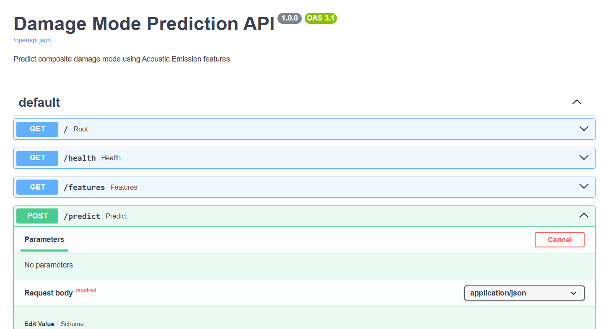
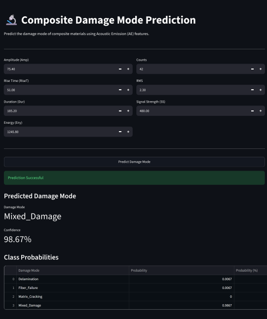

# AE Damage Mode Classification using Acoustic Emission

<p align="center">


</p>

---

# Overview

This project predicts the **Damage Mode of Composite Materials** using **Acoustic Emission (AE) Features** extracted from `.pridb` files.

Instead of manually analyzing thousands of AE hits, the trained machine learning model predicts the damage mode in real time through:

- FastAPI REST API
- Streamlit Web Application

The project is designed to be production-ready with a clean ML pipeline, modular codebase, deployment support, and interactive UI.

---

# Damage Modes

The model predicts one of the following damage mechanisms:

| Class | Description |
|---------|------------|
| Matrix_Cracking | Cracking inside composite matrix |
| Fiber_Failure | Fiber breakage |
| Delamination | Layer separation |
| Mixed_Damage | Combination of multiple failure modes |

---

# Features Used

The trained model uses Acoustic Emission parameters such as

- Amp
- RiseT
- Dur
- Eny
- Counts
- RMS
- SS
- ASL
- FRQ-C
- FRQ-I
- FRQ-P
- FRQ-S
- PeakFreq
- AbsEny
- and other AE parameters

---

# Machine Learning Pipeline

```

Raw Dataset
│
▼
Dataset Builder
│
▼
Preprocessing
│
▼
Train/Test Split
│
▼
Model Training
│
▼
Model Evaluation
│
▼
Best Model Selection
│
▼
damage_mode_pipeline.pkl

```

---

# Model Comparison

The following models were evaluated.

- Balanced Random Forest
- Extra Trees
- Gradient Boosting

The best-performing model is automatically saved as

```

models/
damage_mode_pipeline.pkl

```

---

# Project Structure

```

AE_Damage_Mode/
|
├── api/
│   ├── app.py
│   ├── predictor.py
│   ├── schemas.py
│
├── src/
│   ├── config.py
│   ├── dataset_builder.py
│   ├── preprocessing.py
│   ├── database_reader.py
│   ├── train_model.py
│
├── models/
│   └── damage_mode_pipeline.pkl
│
├── data/
│   ├── raw/
│   └── processed/
│
├── outputs/
│
├── frontend
│
├── requirements.txt
│
└── README.md

```

---

# Installation

Clone the repository

```bash
git clone https://github.com/yourusername/AE_Damage_Mode.git

cd AE_Damage_Mode
```

Install dependencies

```bash
pip install -r requirements.txt
```

---

# Train the Model

```bash
python src/train_model.py
```

The trained pipeline will be saved in

```
models/damage_mode_pipeline.pkl
```

---

# Run FastAPI

API Documentation

```
http://127.0.0.1:8000/docs
```

---

# Streamlit Application

The application provides an easy-to-use interface for predicting damage modes by entering AE feature values.

---

# API Endpoint

POST

```
/predict
```

Example Request

```json
{
  "features": {
    "Amp": 75,
    "RiseT": 45,
    "Dur": 150,
    "Eny": 2100,
    "Counts": 36,
    "RMS": 1.8,
    "SS": 420
  }
}
```

Example Response

```json
{
  "damage_mode": "Mixed_Damage",
  "confidence": 0.9867,
  "probabilities": {
    "Delamination": 0.0067,
    "Fiber_Failure": 0.0067,
    "Matrix_Cracking": 0.0000,
    "Mixed_Damage": 0.9867
  }
}
```

---

# Dataset

The project is trained using Acoustic Emission datasets collected from composite specimens.

Input files include

- `.pridb`
- `.tradb`
- MTS CSV files

The preprocessing stage extracts useful AE hit features for machine learning.

---

# Technologies Used

- Python
- Scikit-learn
- Balanced Random Forest
- FastAPI
- Streamlit
- Joblib
- Pandas
- NumPy
- Matplotlib

---

# Future Improvements

- Get the raw waveform data directly from .tradb files and analyse them
- Explainable AI (SHAP/LIME)
- Cloud deployment
- Real-time Acoustic Emission monitoring
- CI/CD integration
- Unit testing
- Automated model retraining

---

# Screenshots

## FastAPI

```

```

## Streamlit

```

```

---

# Author

Satyam Chaurasiya

Machine Learning • Structural Health Monitoring • Acoustic Emission • Composite Damage Detection

# License

This project is released under the MIT License.
